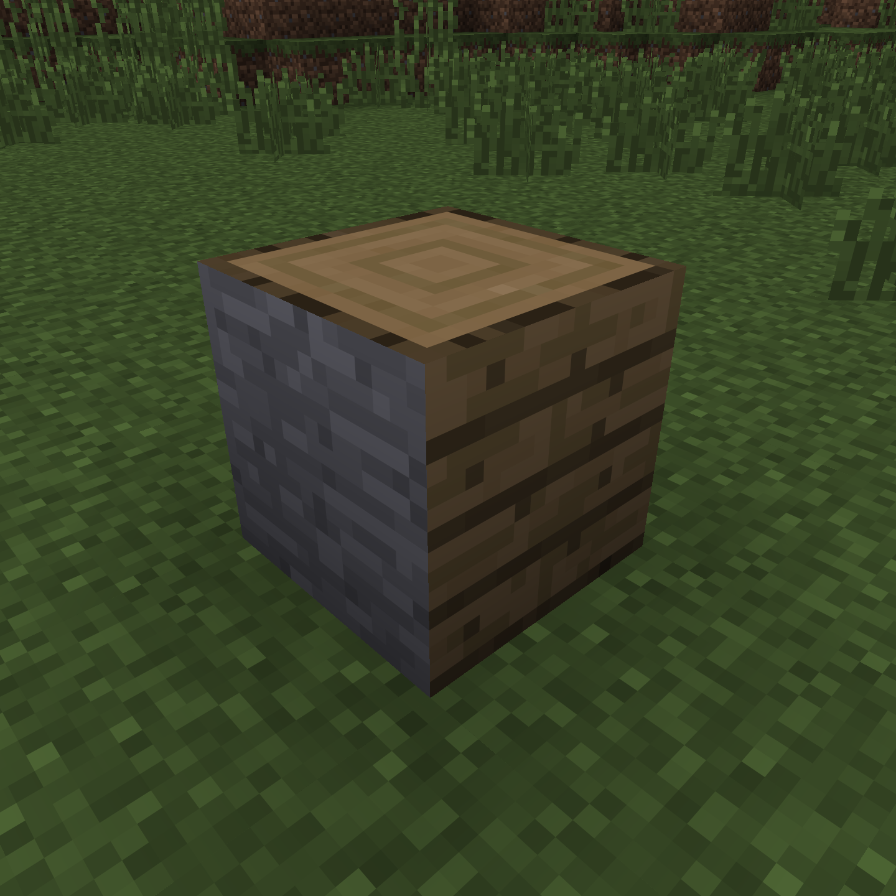
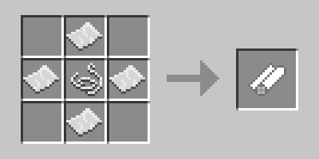
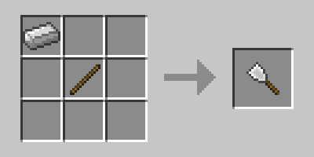
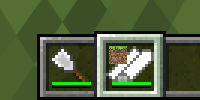

# Abel's Wallpaper Mod

Allows you to paint the texture of any block[^1] on any face of any other block[^2].

[^1]: Only opaque regular cube.
[^2]: Only regular cube, but may be transparent.

## Showcase

  <figure>
    
     
    <figcaption>Usage demo: block of stone with planks texture on one side and log texture on another.</figcaption>
  </figure>

  <figure>
    
     
    <figcaption>Wallpaper roll crafting recipe. Right-click on a block face to copy the texture. Then right click to paint. Put a roll into a crafting grid to clear it (however the durability will not be restored). 1000 durability.</figcaption>
  </figure>

  <figure>
    
     
    <figcaption>Wallpaper scraper crafting recipe. Right-click on a block face to remove the wallpaper. 1000 durability.</figcaption>
  </figure>

  <figure>
    
     
    <figcaption>The mod's items as they appear in the hotbar.</figcaption>
  </figure>

## Status

Ready for use, but not yet heavily tested. No sounds so far.
